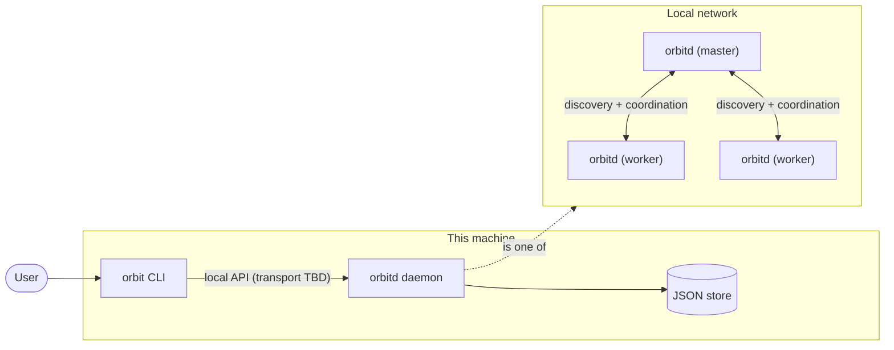
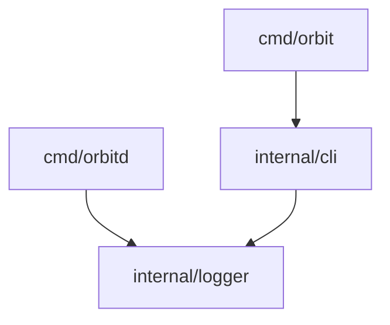

# Orbit

**Turn the machines on your local network into one cloud.**

> [!WARNING]
> Orbit is in **early development** and is **not production-ready**. Most of what this README describes is planned, not built. See [Status](#status) for exactly what exists today.

---

## Overview

Most homes, labs and small offices have several capable machines sitting on the same network: a desktop, a couple of laptops, an old server, maybe a few single-board computers. Each one is managed on its own, and their combined compute mostly sits idle.

Orbit is an open-source, Go-based **local network cloud and distributed worker manager**. It aims to connect those machines and let you manage them as a single computing environment: see which machines are available, what they can contribute, and coordinate work across them, all from one CLI.

## Vision

Managing many machines on a LAN should feel like managing one cloud:

- **Zero-config discovery**: machines running Orbit find each other on the local network automatically.
- **One registry**: a single place that knows every node, its identity, its resources and its health.
- **One interface**: a CLI that works the same whether you have two machines or twenty.
- **Shared compute**: eventually, schedule work onto whichever worker has capacity.

Orbit is built incrementally. Each stage is kept small and solid before the next one starts.

## Roles

Every machine runs the Orbit daemon (`orbitd`) in one of two roles.

| Role | Responsibility |
|---|---|
| **Master** | Discovers worker machines, keeps the node registry, and coordinates operations across the cluster. |
| **Worker** | Contributes compute resources and communicates with the master. |

Users interact with their local daemon through the `orbit` CLI. The daemon does the long-running work: discovery, networking, node management and the other background services.

## Architecture



The repository is a **modular monolith**: one Go module, two independent binaries, and shared packages under `internal/`.



## Status

| Area | Status |
|---|---|
| Shared structured logger (`log/slog`; console / file / both; levels; timestamps; source file:line) | ✅ Implemented |
| CLI root command (Cobra) with logging flags | ✅ Implemented |
| `orbitd` entry point: root context, logger, graceful shutdown on SIGINT/SIGTERM | ✅ Placeholder |
| Daemon lifecycle and HTTP server (`/health`) | 🛠 Planned |
| Persistent node identity (UUID) | 🛠 Planned |
| JSON-file store with atomic writes | 🛠 Planned |
| CLI ↔ daemon communication | 🛠 Planned |
| Node discovery on the LAN (mDNS) | 🛠 Planned |
| Master–worker registration and heartbeats | 🛠 Planned |
| Node management CLI commands | 🛠 Planned |
| Workload scheduling | 🛠 Planned |

## Technology stack

| Purpose | Choice | Status |
|---|---|---|
| Language | Go 1.27 | ✅ In use |
| CLI framework | [`spf13/cobra`](https://github.com/spf13/cobra) | ✅ In use |
| Logging | `log/slog` (standard library) | ✅ In use |
| HTTP routing | [`go-chi/chi/v5`](https://github.com/go-chi/chi) | 🛠 Planned |
| Node identity | [`google/uuid`](https://github.com/google/uuid) | 🛠 Planned |
| Persistence | JSON files (no database) | 🛠 Planned |

The standard library is preferred wherever it is sufficient.

## Repository structure

```text
orbit/
├── cmd/
│   ├── orbit/          # CLI binary entry point
│   └── orbitd/         # Daemon binary entry point (placeholder)
├── internal/
│   ├── cli/            # Cobra root command and CLI wiring
│   └── logger/         # Shared slog logger: levels, outputs, default log paths
├── go.mod
└── README.md
```

New packages (daemon, store, node, API types, config) are added when the first code needs them, not ahead of time.

## Getting started

### Requirements

- Go **1.27.3** or newer (see `go.mod`)

### Build

The two binaries build independently:

```sh
go build -o bin/orbit  ./cmd/orbit
go build -o bin/orbitd ./cmd/orbitd
```

### Run the CLI

```sh
./bin/orbit --help
```

No node commands exist yet. The root command prints help and accepts the global logging flags:

| Flag | Default | Description |
|---|---|---|
| `--log-level` | `warn` | `debug`, `info`, `warn` or `error` |
| `--log-output` | `console` | `console` (stderr), `file` or `both` |
| `--log-file` | per-OS default (below) | Log file used when output is `file` or `both` |

```sh
./bin/orbit --log-level debug --log-output both
```

### Run the daemon

```sh
./bin/orbitd
```

The placeholder daemon logs to the console and to its log file, then waits. Stop it with `Ctrl+C` or `kill <pid>` (SIGINT/SIGTERM). It logs the shutdown and exits cleanly.

### Log files

Log lines are plain text with a timestamp, level and source location:

```text
time=2026-11-11T12:29:52.510+05:30 level=INFO source=orbitd/main.go:45 msg="orbitd started" pid=67464
```

Default log file locations (`<name>` is `orbit` or `orbitd`):

| OS | Path |
|---|---|
| macOS | `~/Library/Logs/Orbit/<name>.log` |
| Linux | `$XDG_STATE_HOME/orbit/<name>.log` (default `~/.local/state/orbit/<name>.log`) |
| Windows | `%LocalAppData%\Orbit\logs\<name>.log` |

### Development checks

```sh
gofmt -l .
go vet ./...
go test ./...
```

## Roadmap

1. **Foundation**: repository layout, shared logger, CLI root, daemon entry point. *(in progress)*
2. **Daemon core**: daemon lifecycle, HTTP server with `/health`, persistent node identity, JSON store.
3. **CLI ↔ daemon**: local communication between the CLI and the daemon on the same machine, plus the first real commands (e.g. status).
4. **Discovery**: master and workers find each other on the LAN.
5. **Membership**: worker registration with the master, heartbeats and health tracking.
6. **Node management**: CLI commands to list, inspect and manage nodes.
7. **Workloads**: scheduling work onto workers.

The order and scope may change as the project evolves.

## Contributing

Contribution guidelines will be added once the core architecture settles. Until then, feel free to open an issue to discuss ideas or report problems.

## License

To be decided.
